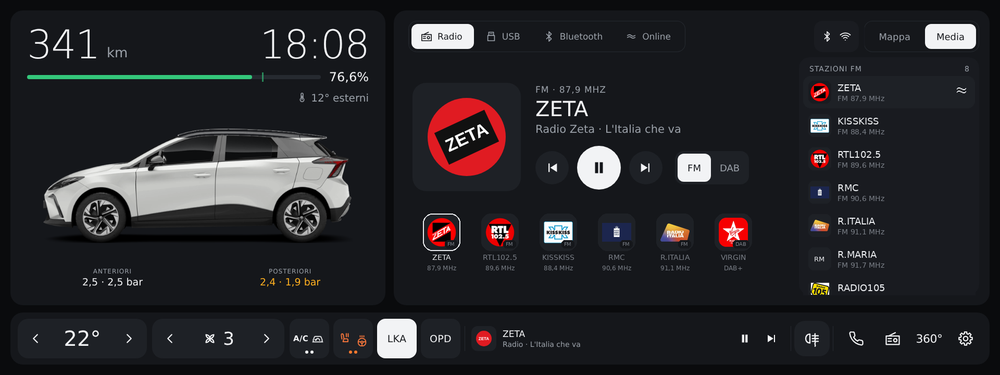

# MG4 Launcher — SWI132 (MG4 MY24)

🇮🇹 [Italiano](#italiano) · 🇬🇧 [English](#english)

**Ultima versione / Latest version: [0.2.0](releases/MG4Launcher-SWI132-0.2.0.apk)** · 🧪 **sperimentale / experimental**

<a href="https://www.paypal.com/pool/9tv7fQ36nA?sr=wccr"></a>

> ⚠️ **Compatibilità / Compatibility:** solo infotainment **SWI132 (MG4 MY24)** · only **SWI132 (MG4 MY24)** infotainment.
> Per gli altri software / for the other software: **SWI68 SAIC 1.0+** → [Mg4-Launcher-SWI68](https://github.com/ernestomicco2026-cell/Mg4-Launcher-SWI68) ·
> **SWI69 Color Radio** → [Mg4-Launcher-SWI69](https://github.com/ernestomicco2026-cell/Mg4-Launcher-SWI69) ·
> **SWI133 (MG4 Luxury MY24)** → [Mg4-Launcher-SWI133](https://github.com/ernestomicco2026-cell/Mg4-Launcher-SWI133).

> 🧪 **Versione sperimentale: ho bisogno di voi.** Non ho un'auto con il software SWI132, quindi questa versione non
> l'ho mai potuta provare in auto: l'ho costruita leggendo il firmware `SWI132-29958-1100R43`, partendo dal launcher
> SWI69. **Solo voi che avete questo software potete aiutarmi a migliorarlo.** Se la installate, lasciate attivo
> **Invio log** (è già acceso) oppure mandatemi il log diagnostico (**Salva log** nelle impostazioni) e
> segnalatemi cosa funziona e cosa no.
>
> 🧪 **Experimental version: I need your help.** I don't have a car with SWI132 software, so I have never been able to
> test this version in a car: I built it by reading the `SWI132-29958-1100R43` firmware, starting from the SWI69
> launcher. **Only those of you who have this software can help me improve it.** If you install it, keep
> **Log upload** on (it is on by default) or send me the diagnostic log (**Save log** in the settings), and tell me
> what works and what doesn't.

> Progetto amatoriale e **non ufficiale**: non è affiliato né approvato da MG Motor o SAIC Motor.
> I nomi MG / MG4 servono solo a indicare l'auto compatibile (infotainment SWI132 - MY24). Installalo e usalo a tuo rischio.
>
> Hobby project, **not official**: not affiliated with or endorsed by MG Motor or SAIC Motor.
> The MG / MG4 names only identify the compatible car (SWI132 infotainment). Install and use it at your own risk.

---


<sub>Anteprima della home 0.2.0: grafica identica alla versione SWI69 0.3.2, con il gruppo Comfort (auto con sedili e volante riscaldati); i valori, le stazioni e i loghi sono di esempio · Preview of the 0.2.0 home: same design as SWI69 version 0.3.2, with the Comfort group (car with heated seats and steering wheel); values, stations and logos are examples.</sub>

---

## Video recensione / Video review

<a href="https://youtu.be/JKZ0N3Lr7FI"></a>

Guarda la [video recensione su YouTube](https://youtu.be/JKZ0N3Lr7FI) · Watch the [video review on YouTube](https://youtu.be/JKZ0N3Lr7FI).

---

## Sostieni il progetto / Support the project

MG4 Launcher è gratuito e lo resterà. Se ti è utile e ti va di contribuire alle ore passate a svilupparlo e a provarlo
in auto, puoi lasciare una piccola offerta libera. È del tutto **facoltativa**: grazie anche solo per usarlo e per
le segnalazioni.

MG4 Launcher is free and will stay free. If you find it useful and would like to support the hours spent building and
testing it in the car, you can leave a small donation of any amount. It is entirely **optional**: thank you just for
using it and reporting issues.

<a href="https://www.paypal.com/pool/9tv7fQ36nA?sr=wccr"></a>

## Quale versione installare? / Which version should I install?

Ci sono **quattro launcher diversi**, uno per ciascun software dell'infotainment MG4. Non sono intercambiabili:
servizi dell'auto, radio, media e clima sono diversi. Se installi la versione sbagliata, il launcher lo riconosce,
mostra un avviso con il link alla versione giusta e non tenta nessun collegamento all'auto.

| Software dell'auto | Auto | Repository | File APK |
|---|---|---|---|
| **SWI68 SAIC 1.0+** | MG4 | [Mg4-Launcher-SWI68](https://github.com/ernestomicco2026-cell/Mg4-Launcher-SWI68) | `MG4Launcher-X.Y.Z.apk` |
| **SWI69 Color Radio** | MG4 MY23 | [Mg4-Launcher-SWI69](https://github.com/ernestomicco2026-cell/Mg4-Launcher-SWI69) | `MG4Launcher-SWI69-X.Y.Z.apk` |
| **SWI132** | MG4 MY24 | **questo repository** | `MG4Launcher-SWI132-X.Y.Z.apk` |
| **SWI133** | MG4 Luxury MY24 | [Mg4-Launcher-SWI133](https://github.com/ernestomicco2026-cell/Mg4-Launcher-SWI133) | `MG4Launcher-SWI133-X.Y.Z.apk` |

**Come sapere quale software hai:** con il computer collegato all'auto
`adb shell getprop ro.build.mt2712.version` → l'inizio dice il software: `SWI68-…`, `SWI69-…`, `SWI132-…` o `SWI133-…`.
Se il launcher è già installato: impostazioni → riga **MG4 Launcher X.Y.Z · repository** sotto *Aggiornamenti*;
il nome del repository dice quale versione hai.

There are **four different launchers**, one per MG4 infotainment software, and they are not interchangeable. If you
install the wrong one, the launcher recognises it, shows a notice with a link to the right version and does not try to
connect to the car. Check your software with `adb shell getprop ro.build.mt2712.version` (it starts with `SWI68-`, `SWI69-`, `SWI132-` or
`SWI133-`) and use the matching repository above.

---

## Italiano

Launcher in stile Tesla per l'infotainment della **MG4 MY24** con software **SWI132**
(EH32, Android Automotive 9, build `SWI132-29958-1100R43`).

**Compatibilità:** funziona **solo con il software SWI132**. La SWI132 è il software delle MG4 MY24 e corrisponde
alla versione standard della SWI69: i servizi dell'auto sono gli stessi, ma è un software a sé, quindi ha il suo
launcher. Sostituisce la schermata home originale mantenendone le funzioni, con la stessa grafica, le stesse opzioni
e le stesse lingue della versione SWI69.

**Stato: sperimentale.** Non avendo un'auto con la SWI132, non ho potuto provarla. Ho confrontato una per una nel
firmware tutte le cose che il launcher usa (app originali, servizi, comandi del clima, della ricarica e delle luci,
proprietà della batteria, radio, media, CarPlay e Android Auto): sono identiche alla SWI69, che funziona. Però
**solo chi ha questo software può dirmi se va davvero**: i log che il launcher invia da solo sono il modo più
semplice per aiutarmi a migliorarlo.

### Cosa fa

- **Auto e batteria** (a sinistra): autonomia e **orologio** grandi, barra batteria con la percentuale accanto e la
  tacca del limite di ricarica, temperatura esterna; lo stato compare solo durante la ricarica o il V2L (tipo, potenza,
  tempo rimanente). Nelle impostazioni si attivano la **data** accanto all'ora, la percentuale con un decimale, la
  pressione degli pneumatici (TPMS) con l'unità a scelta (come il quadro, bar, kPa o psi), la temperatura interna (se
  l'auto la fornisce) e i **pulsanti di ricarica** (limite di ricarica, corrente AC e avvia/ferma ricarica o V2L, con
  conferma). La tua MG4 ricolorabile con gli 8 colori della gamma, tetto nero opzionale.
  Tocca l'auto o V2L → app Energia. Tieni premuta l'auto → impostazioni del launcher.
- **Mappa / Media / CarPlay** (a destra):
  - **Mappa**: il pannello è pensato per **CarPlay / Android Auto**, come sulla SWI69. Senza guida una scheda
    mostra lo stato del telefono: collegato → pulsante **Apri CarPlay / Android Auto**; non collegato → ti ricorda
    di collegarlo. Durante la guida il pannello mostra le indicazioni del telefono. Sulla SWI132 c'è anche il
    **navigatore MG** (Nav): senza telefono collegato, toccando la barra della scheda Mappa si apre quello; lo trovi anche nella pagina App.
  - **Media**: parte dalla sorgente in riproduzione, altrimenti dalla radio; in alto un pulsante per ogni sorgente
    (Radio, USB, Bluetooth, Online se disponibile, e CarPlay/Android Auto se il telefono è collegato);
    con più di 4 sorgenti quelle non selezionate mostrano solo l'icona.
    Per la radio: il **logo** della stazione nella copertina (il nome solo se il logo manca), **preferiti** e, a destra,
    **FM / DAB** con l'**elenco delle stazioni**: DAB dal servizio radio (**Aggiorna** per rileggerlo), FM dalla
    ricerca (**Cerca**) e dalle stazioni già ascoltate. Tocca una stazione per sintonizzarla, tienila premuta per
    aggiungerla o toglierla dai preferiti; tieni premuto un preferito per eliminarlo.
    **Loghi radio**: i tuoi nella cartella **MG4Launcher/loghi** (es. `MG4Launcher/loghi/NOME.png`, sulla memoria o su
    una chiavetta: hanno la priorità), quelli trasmessi dalle stazioni DAB e quelli scaricati quando c'è internet,
    salvati per sempre e riusati senza rete.
  - **CarPlay / Android Auto**: la scheda compare da sola quando colleghi il telefono.
  - In alto a destra, prima delle schede, una pillola con **Bluetooth** (pieno = telefono collegato, sbiadito = acceso)
    e **Wi-Fi** con 4 tacche di segnale (solo quando è collegato).
- **Barra in basso**, con comandi grandi da usare guidando: temperatura ‹ › (LO, 16…30, HI) e ventola ‹ ›
  (OFF / 1…11 / A = automatico; tocca il numero = app Clima, tieni premuto = accendi/spegni), pulsanti **A/C** e
  **AUTO** (acceso = colori invertiti), **ricircolo** (solo se l'auto lo supporta), mini-player compatto,
  **retronebbia** (icona ambra da acceso; Automatico = nascosto se la barra di sistema mostra già la sua spia,
  oppure Mostra / Nascondi) e **fendinebbia anteriori** (verde, solo se l'auto li ha), Telefono, Radio, **360°**
  (telecamere), Impostazioni. Con la **barra grande** (opzione) i pulsanti del clima sono più grandi e il mini-player
  lascia il posto (la musica resta nel pannello Media).
- **App**: scorri la home verso sinistra per le app dell'auto e quelle che installi tu,
  con le icone tutte nello stesso stile; scorri verso destra per tornare. Con **Modifica** scegli quali app installate mostrare.
  In fondo alle app dell'auto ci sono anche **Impostazioni Android** e **File Android** (solo se presenti sull'auto).
- **Dimensione comandi** (Normale / Grande / Molto grande): ingrandisce pulsanti, icone e testi dei pulsanti
  in proporzione, per usarli meglio guidando.
- **Guida a destra o a sinistra**: automatica dalla configurazione dell'auto o scelta nelle impostazioni; con la
  guida a destra la home si specchia, con auto e clima dal lato del guidatore. Sulle auto che mostrano sempre la
  spia luci del sistema in alto a sinistra, quell'angolo resta libero.
- **Impostazioni** (tieni premuta l'auto), divise in sezioni con un menu laterale: **Auto** (colore, tetto nero),
  **Home** (decimali, pressione pneumatici, temperatura interna), **Aspetto** (tema, dimensione comandi, lingua),
  **Guida** (posizione di guida, home MG originale), **Sistema** (aggiornamenti, invio e salvataggio log, diagnostica).
  In fondo al menu sono sempre visibili la versione e, quando c'è, la nuova versione con **Installa**.
  Si aprono anche dall'ingranaggio in alto a destra nella pagina App.
- **Avvio all'accensione**: il launcher torna davanti da solo se il sistema apre la home MG; in più l'opzione
  **Premi Home da solo dopo l'accensione** (spento, 5, 10, 15, 20 o 30 secondi), una volta sola e solo se c'è la home MG.
- **Novità**: al primo avvio dopo un aggiornamento un popup elenca in breve le novità (una volta per versione).
- **Lingue**: italiano, inglese, spagnolo, tedesco, portoghese, francese, turco e polacco. Con **Come l'auto** (predefinita)
  il launcher usa la lingua di sistema e si aggiorna da solo quando la cambi nell'auto; altrimenti scegli una lingua
  nelle impostazioni. Per le lingue non tradotte usa l'inglese.
- **Schermo intero**: barra di stato e dock MG nascosti (trascina dal bordo per richiamarli).
- **Aggiornamenti**: le nuove versioni si scaricano e si installano dalle impostazioni, senza computer. Quando ne
  esce una, compare in basso a destra un piccolo avviso con **Aggiorna** / **Più tardi** (sparisce da solo; "Più tardi"
  lo rimanda di un giorno).
- **Musica che riprende da sola**: se una notifica del telefono fa passare la musica Bluetooth (o USB / online)
  alla radio, il launcher rimette in riproduzione la tua musica dopo qualche secondo. Non interviene se la radio
  l'hai scelta tu.
- **Invio dei log**: il launcher invia in automatico la diagnostica allo sviluppatore
  (all'avvio, ogni 30 minuti e con **Salva log**), per poter correggere i problemi senza dover raccogliere i file a mano.
  Contiene solo versione, valori letti dai servizi dell'auto ed errori: niente posizione, telaio o dati del telefono.
  Si disattiva nelle impostazioni (**Invio log**).

### Installazione

Solo per infotainment **SWI132 (MG4 MY24)**. Scarica l'APK dalla cartella [`releases/`](releases/).
Ci sono due modi per installarlo: da chiavetta USB, se riesci ad aprire un file manager sull'auto, oppure con adb da computer.

#### Metodo 1 — Da chiavetta USB (senza computer)

Serve poter aprire un file manager sull'infotainment.

1. Copia `MG4Launcher-SWI132-0.2.0.apk` su una chiavetta USB formattata **FAT32** o **exFAT**.
2. Inserisci la chiavetta nell'auto, apri il file manager e tocca l'APK.
3. Se Android avvisa che non può installare app da questa fonte: tocca **Impostazioni**, attiva
   **Consenti da questa fonte** per il file manager e torna indietro.
4. Tocca **Installa**.
5. Premi il tasto **Home**: Android chiede quale home usare. Scegli **MG4 Launcher** e poi **Sempre**.

Se **Impostazioni** non apre nulla o l'installazione dà errore, usa il metodo 2
(e, se puoi, segnala il messaggio d'errore).

#### Metodo 2 — Con adb da computer

Serve un computer con [adb](https://developer.android.com/tools/releases/platform-tools) collegato all'auto.
Il firmware MG può bloccare l'installazione normale delle app: l'opzione `-f` la permette.

1. Installa:
   ```bash
   adb install -r -f MG4Launcher-SWI132-0.2.0.apk
   ```
2. Rendilo la home predefinita:
   ```bash
   adb shell cmd package set-home-activity com.mg4.launcher/.MainActivity
   ```
   In alternativa premi il tasto Home: Android chiede quale home usare.

> **Se premendo Home Android non chiede quale home usare** (il tasto apre direttamente la home MG): non serve fare
> altro, il launcher si sostituisce da solo alla home MG ogni volta che compare.
> Se hai un'app che rimappa i tasti (es. **MG4 Control**), controlla che il tasto Home non sia assegnato alla
> home MG.

Con entrambi i metodi il launcher parte poi da solo all'accensione dell'auto, come la home originale,
e gli aggiornamenti successivi si fanno dalle impostazioni del launcher, senza chiavetta né computer.

### Aggiornamenti

Impostazioni del launcher → **Sistema** → **Aggiornamenti** → **Controlla**.
Se c'è una versione più nuova compare **Installa** (anche in fondo al menu delle impostazioni): il launcher la installa da solo e si riavvia.
Serve che l'auto sia collegata a internet (connettività dell'auto o hotspot del telefono).
Gli aggiornamenti arrivano solo da questo repository: una versione per un altro software non viene mai proposta.
Se prima avevi installato la versione SWI69, il launcher passa da solo a questo repository.
Si possono installare anche da computer, con lo stesso comando dell'installazione.

### Tornare alla home MG originale

Dal launcher: impostazioni → **Apri la home originale MG**. Per renderla di nuovo quella predefinita:

```bash
adb shell cmd package set-home-activity com.saicmotor.launcher/.view.MainActivity
```

Per rimuovere del tutto il launcher: `adb uninstall com.mg4.launcher`. L'app originale non viene mai modificata.

### Comandi utili

```bash
# riavviare il launcher senza spegnere l'auto
adb shell am force-stop com.mg4.launcher
adb shell am start -n com.mg4.launcher/.MainActivity

# vedere i valori letti dall'auto (Ctrl+C per fermare)
adb logcat -s MG4L MG4L.Link

# scaricare la diagnostica salvata dal launcher (aggiornata ogni 15 s)
adb pull /sdcard/Android/data/com.mg4.launcher/files/diagnostica.txt
```

### Segnalare un problema (e aiutarmi a migliorarlo)

Questa versione è sperimentale e io non ho un'auto SWI132: **ogni log è prezioso**.

- **Invio log** (impostazioni → Sistema) è acceso di serie: il launcher manda da solo la diagnostica all'avvio, ogni
  30 minuti e quando premi **Salva log**. Lascialo acceso, soprattutto nei primi giorni.
- Con **Salva log** (in alto nella colonna Diagnostica) il launcher scrive un log completo — valori, errori, eventi
  recenti e logcat del launcher — in `Android/data/com.mg4.launcher/files/mg4-launcher-log-….txt`.
  Se è inserita una chiavetta USB il file finisce anche lì, nella stessa cartella.
- Nelle impostazioni la colonna **Diagnostica servizi auto** mostra i valori letti dall'auto e gli errori recenti:
  anche uno screenshot di quella colonna aiuta molto.

Insieme al log, scrivi in una [segnalazione](https://github.com/ernestomicco2026-cell/Mg4-Launcher-SWI132/issues) cosa funziona e cosa no (batteria,
ricarica, clima, fendinebbia, radio, media, CarPlay / Android Auto, telecamere) e la revisione del software.

### Versioni

#### 0.2.0

Stesse novità della versione SWI69 0.3.2 (e SWI68 0.8.2 e 0.8.3), con i servizi della SWI132, verificati sul firmware
`SWI132-29958-1100R43`.
- **Pulsanti raggruppati** nella barra: **Clima** (A/C, AUTO, ricircolo) e **Comfort** (sedili e volante riscaldati).
  Un tocco apre sopra la barra un riquadro con le caselle grandi (si chiude toccando fuori o da solo dopo pochi
  secondi); pressione lunga: A/C e sedile guida. Funzionano anche con la barra grande, che ora ha di nuovo il mini
  player. Si possono spegnere nelle impostazioni (*Pulsanti raggruppati*). Il gruppo **Comfort** mostra solo i comandi
  che l'auto ha (come l'app Clima originale della SWI132); se non ce n'è nessuno, non compare.
- **LKA** (mantenimento corsia) e **OPD** (One Pedal Drive) nella barra, con lo stato reale dell'auto e gli stessi
  comandi dell'app Impostazioni veicolo: solo comando manuale, nessun automatismo all'avvio. Compaiono solo se l'auto li
  ha; si possono nascondere.
- **Pacchetti dei loghi radio per paese**, per FM e DAB: si scaricano una volta da questo repository (con controllo
  dell'integrità) e poi funzionano senza internet; paese automatico (dal **fuso orario** dell'auto, poi dalla lingua del
  launcher, confermato dalle stazioni DAB) o scelta di uno o più paesi, *Aggiorna* ed *Elimina* nelle impostazioni,
  installazione da chiavetta. I nomi DAB con `#` davanti e le varianti di una stazione (es. RTL 102.5) trovano il logo.
- **Nome delle stazioni sempre visibile**: nella lista delle stazioni e nei preferiti ci sono sempre logo, nome e
  frequenza (o DAB+). Solo nella copertina grande il logo resta da solo, con il nome accanto.
- **Riavvio del dongle CarPlay/Android Auto** che non si collega: solo con un dongle wireless riconosciuto (mai con un
  telefono via cavo o una chiavetta), al massimo 2 tentativi per accensione, mai durante una chiamata. Attesa
  regolabile e pulsante *Riavvia CarPlay/AA* nelle impostazioni.
- Launcher più leggero: log senza le righe di sistema ripetitive, tolti testi e icone non più usati, immagini dell'auto
  più leggere (identiche), i loghi non sono più dentro l'app.

#### 0.1.0

Prima versione per il software **SWI132 (MG4 MY24)**, **sperimentale**: non provata in auto, aspetto i vostri log.

**Novità**
- Stessa grafica, stesse opzioni, stessi testi e stesse lingue della versione **SWI69 0.3.1**.
- Servizi dell'auto verificati sul firmware `SWI132-29958-1100R43`: app originali, servizio veicolo, comandi di
  clima, ricarica, batteria, luci e fendinebbia, proprietà del sistema auto, radio, media, CarPlay e Android Auto
  sono identici alla SWI69. Cambiano solo i nomi delle cartelle di sistema delle app.
- **Navigatore MG** (Nav, presente sulla SWI132): compare nella pagina App e, senza telefono collegato, si apre
  toccando la barra della scheda Mappa.
- **Riconoscimento del software**: all'avvio il launcher legge il software dell'auto e distingue SWI68, SWI69,
  SWI132 e SWI133. Se è installato sull'auto sbagliata mostra un avviso con il link alla versione giusta e non tenta
  collegamenti.
- Aggiornamenti dall'app solo da questo repository; se era salvato il repository di un'altra versione, si passa da
  soli a questo.
- I log diagnostici vanno nella cartella **SWI132** del repository dei log.

### Compilare

Il launcher si compila con lo script `build.sh` incluso, senza Gradle; alcuni strumenti Android necessari non sono
nel repository e vanno aggiunti in `tools/`. La versione è in `version.properties`, i testi delle 8 lingue in
`tools/i18n.py` (polacco in `tools/i18n_pl.py`). Gli APK pubblicati sono nella cartella `releases/`.

### Come comunica con l'auto

Il launcher usa gli stessi servizi di sistema della home originale **SWI132**: veicolo e batteria, clima,
luci, media, radio e CarPlay / Android Auto. Legge i dati e invia all'auto solo i comandi che tocchi tu (clima,
fendinebbia, sorgenti e brani); non modifica nulla del sistema.

La mappa di CarPlay / Android Auto non può essere mostrata dentro il launcher:
il pannello Mappa mostra le indicazioni del telefono e apre CarPlay / Android Auto a schermo intero.

### Note

- L'immagine dell'auto deriva da una foto ufficiale MG; marchi e immagini appartengono ai rispettivi proprietari.
- I loghi delle stazioni FM vengono da [radio-browser.info](https://www.radio-browser.info), database pubblico e gratuito.

---

## English

Tesla-style launcher for the **MG4 MY24** infotainment system running **SWI132** software
(EH32, Android Automotive 9, build `SWI132-29958-1100R43`).

**Compatibility:** works **only with SWI132**. SWI132 is the MG4 MY24 software and matches the standard SWI69: the car
services are the same, but it is separate software, so it has its own launcher. It replaces the original home screen,
keeping its features, with the same design, options and languages as the SWI69 version.

**Status: experimental.** As I don't have a car with SWI132, I couldn't test it. I compared one by one in the firmware
everything the launcher uses (original apps, services, climate, charging and light commands, battery properties,
radio, media, CarPlay and Android Auto): they are identical to SWI69, which works. But **only people with this
software can tell me whether it really works**: the logs the launcher sends by itself are the easiest way to help me
improve it.

### Features

- **Car and battery** (left): large range and **clock**, battery bar with the percentage next to it and a
  charge-limit mark, outside temperature; the status shows only while charging or using V2L (type, power, time left).
  The settings turn on the **date** next to the time, the percentage with one decimal, the tyre pressure (TPMS) with a
  choice of unit (as on the cluster, bar, kPa or psi), the inside temperature (if the car provides it) and the
  **charging buttons** (charge limit, AC current and start/stop charging or V2L, with confirmation). Your MG4, recolourable with the 8 factory colours, optional black roof.
  Tap the car or V2L → Energy app. Long-press the car → launcher settings.
- **Map / Media / CarPlay** (right):
  - **Map**: the panel is designed for **CarPlay / Android Auto**, as on SWI69. When not guiding, a card shows the
    phone status with an **Open CarPlay / Android Auto** button (or a reminder to connect the phone); while guiding,
    the panel shows the phone's directions. SWI132 also has the **MG navigator** (Nav): with no phone connected, tapping the bar on
    the Map card opens it; it is on the Apps page too.
  - **Media**: starts on the source that is playing, otherwise the radio; one button per source at the top
    (Radio, USB, Bluetooth, Online when available, plus CarPlay/Android Auto when a phone is connected);
    with more than 4 sources the unselected ones show only their icon.
    Radio: the station **logo** on the cover (the name only when there is no logo), **favourites** and, on the right,
    **FM / DAB** with the **station list** (DAB from the radio service, FM from a scan and from stations you have
    listened to). Tap a station to tune in, long-press it to add/remove it from favourites.
    **Radio logos**: your own in the **MG4Launcher/loghi** folder (e.g. `MG4Launcher/loghi/NAME.png`, on the storage or
    a USB stick: they take priority), the ones sent by DAB stations and the ones downloaded when online, kept for good
    and reused offline.
  - **CarPlay / Android Auto**: the tab appears by itself when you connect a phone.
  - Top right, before the tabs, a pill with **Bluetooth** (solid = phone connected, faded = on) and **Wi-Fi** with
    4 signal bars (only when connected).
- **Bottom bar**, with large controls for use while driving: temperature ‹ › (LO, 16…30, HI) and fan ‹ ›
  (OFF / 1…11 / A = auto; tap the number = Climate app, long-press = climate on/off), **A/C** and **AUTO** buttons
  (on = inverted colours), **recirculation** (only if the car supports it), compact mini player, **rear fog light**
  (amber when on; Automatic = hidden if the system bar already shows its indicator, or Show / Hide) and **front fog
  lights** (green, only if fitted), Phone, Radio, **360°** (cameras), Settings. With the **large bar** (option) the
  climate buttons are bigger and the mini player makes room (music stays in the Media panel).
- **Apps**: swipe the home screen left for the car's apps and the ones you install; swipe right to go back.
  Use **Modifica** (Edit) to choose which installed apps to show. At the end of the car's apps there are also
  **Android settings** and **Android files** (only if present on the car).
- **Control size** (Normal / Large / Extra large): scales buttons, icons and button labels proportionally,
  for easier use while driving.
- **Right- or left-hand drive**: automatic from the car configuration or chosen in the settings; with right-hand
  drive the home screen is mirrored, with car and climate on the driver's side. On cars that always show the
  system light indicator at the top left, that corner is kept free.
- **Settings** (long-press the car), split into sections with a side menu: **Car** (colour, black roof),
  **Home** (decimals, tyre pressure, inside temperature), **Appearance** (theme, control size, language),
  **Driving** (driving side, original MG home), **System** (updates, log upload and saving, diagnostics).
  The version, and a new version with **Install** when available, are always shown at the bottom of the menu. Also available from the gear at the top right of the Apps page.
- **Full screen**: status bar and MG dock hidden (swipe from the edge to bring them back).
- **Updates**: new versions download and install from the settings, no computer needed. When one is out, a small
  notice with **Update** / **Later** appears at the bottom right (it hides by itself; "Later" waits a day).
- **Music that resumes by itself**: if a phone notification makes the Bluetooth (or USB / online) music switch to
  the radio, the launcher resumes your music after a few seconds. It does nothing if you chose the radio yourself.
- **Log upload**: the launcher automatically sends its diagnostics to the developer (at start,
  every 30 minutes and with **Save log**). Only version, values read from the car services and errors: no location,
  VIN or phone data. It can be turned off in the settings (**Log upload**).

- **Start at power-on**: the launcher comes back to the front by itself if the system opens the MG home; plus the
  **Press Home automatically after power-on** option (off, 5, 10, 15, 20 or 30 seconds), once only and only over the MG home.
- **What's new**: on the first start after an update a popup briefly lists what's new (once per version).

**Languages:** Italian, English, Spanish, German, Portuguese, French, Turkish and Polish. **Same as car** (default) follows
the system language and updates by itself when you change it in the car; or pick a language in the settings.
Other system languages fall back to English.

### Installation

Only for **SWI132 (MG4 MY24)** infotainment. Download the APK from the [`releases/`](releases/) folder.
There are two ways to install it: from a USB stick, if you can open a file manager on the car, or with adb from a computer.

#### Method 1 — From a USB stick (no computer)

You need to be able to open a file manager on the infotainment.

1. Copy `MG4Launcher-SWI132-0.2.0.apk` to a USB stick formatted as **FAT32** or **exFAT**.
2. Plug it into the car, open the file manager and tap the APK.
3. If Android says it cannot install apps from this source: tap **Settings**, enable
   **Allow from this source** for the file manager and go back.
4. Tap **Install**.
5. Press the **Home** button: Android asks which home app to use. Pick **MG4 Launcher**, then **Always**.

If **Settings** does nothing or the install fails, use method 2 (and, if you can, report the error message).

#### Method 2 — With adb from a computer

You need a computer with [adb](https://developer.android.com/tools/releases/platform-tools) connected to the car.
The MG firmware may block normal app installs; the `-f` option allows it.

1. Install it:
   ```bash
   adb install -r -f MG4Launcher-SWI132-0.2.0.apk
   ```
2. Make it the default home:
   ```bash
   adb shell cmd package set-home-activity com.mg4.launcher/.MainActivity
   ```
   Or press the Home button: Android asks which home app to use.

> **If pressing Home doesn't ask which home to use** (the button opens the MG home directly): nothing else is needed,
> the launcher replaces the MG home by itself whenever it appears.
> If you have an app that remaps the buttons (e.g. **MG4 Control**), check that the Home button isn't assigned to
> the MG home.

Either way, the launcher then starts by itself when the car switches on, like the original home,
and later updates are installed from the launcher settings, with no USB stick or computer.

### Updates

Launcher settings → **System** → **Updates** → **Check**.
If a newer version exists, **Install** appears (also at the bottom of the settings menu): the launcher installs it and restarts.
The car needs an internet connection (car connectivity or phone hotspot). Updates come only from this repository:
a build for another software is never offered. If you had installed the SWI69 version before, the launcher switches
to this repository by itself.

### Going back to the original MG home

From the launcher: settings → **Apri la home originale MG**. To make it the default again:

```bash
adb shell cmd package set-home-activity com.saicmotor.launcher/.view.MainActivity
```

To remove the launcher completely: `adb uninstall com.mg4.launcher`. The original app is never modified.

### Reporting a problem (and helping me improve it)

This version is experimental and I don't have a SWI132 car: **every log is precious**.

- **Log upload** (settings → System) is on by default: the launcher sends its diagnostics by itself at start, every
  30 minutes and when you press **Save log**. Please keep it on, especially in the first days.
- **Save log** (top of the Diagnostics column) writes a full log to
  `Android/data/com.mg4.launcher/files/mg4-launcher-log-….txt` (also on a USB stick, if one is plugged in).
- Settings → **Diagnostica servizi auto** shows the raw values read from each car service and recent errors: a
  screenshot of that column helps a lot too.

Together with the log, describe in an [issue](https://github.com/ernestomicco2026-cell/Mg4-Launcher-SWI132/issues) what works and what doesn't (battery,
charging, climate, fog lights, radio, media, CarPlay / Android Auto, cameras) and your software revision.

### Changelog

#### 0.2.0

Same changes as the SWI69 version 0.3.2 (and SWI68 0.8.2 and 0.8.3), with the SWI132 services, checked on the
`SWI132-29958-1100R43` firmware.
- **Grouped buttons** in the bar: **Climate** (A/C, AUTO, recirculation) and **Comfort** (heated seats and steering
  wheel). One tap opens a panel with big tiles above the bar (it closes when you tap outside or by itself after a few
  seconds); long press: A/C and driver seat. They also work with the large bar, which now has the mini player again.
  They can be turned off in settings (*Grouped buttons*). The **Comfort** group only shows the controls your car has
  (like the original SWI132 Climate app); if there are none, it does not appear.
- **LKA** (lane keeping) and **OPD** (One Pedal Drive) in the bar, with the car's real state and the same commands as the
  Vehicle settings app: manual command only, nothing automatic at start-up. They only appear if the car has them; they
  can be hidden.
- **Radio logo packs per country**, for FM and DAB: downloaded once from this repository (with an integrity check) and
  then they work offline; automatic country (from the car's **time zone**, then the launcher language, confirmed by DAB
  stations) or one or more countries of your choice, *Update* and *Delete* in settings, install from a USB stick. DAB
  names starting with `#` and station variants (e.g. RTL 102.5) find their logo.
- **Station names always shown**: the station list and the favourites always show logo, name and frequency (or DAB+).
  Only the large cover keeps the logo on its own, with the name next to it.
- **Restart of a CarPlay/Android Auto dongle** that does not connect: only with a recognised wireless dongle (never with a
  wired phone or a USB stick), at most 2 attempts per start, never during a call. Adjustable wait and a *Restart
  CarPlay/AA* button in settings.
- Lighter launcher: logs without repetitive system lines, unused texts and icons removed, lighter car images (identical),
  logos no longer inside the app.

#### 0.1.0

First version for **SWI132 (MG4 MY24)** software, **experimental**: not tested in a car, waiting for your logs.

**New**
- Same design, options, texts and languages as **SWI69 version 0.3.1**.
- Car services checked on the `SWI132-29958-1100R43` firmware: original apps, vehicle service, climate, charging,
  battery, light and fog-light commands, car system properties, radio, media, CarPlay and Android Auto are identical
  to SWI69. Only the system folder names of the apps change.
- **MG navigator** (Nav, present on SWI132): shown on the Apps page and, with no phone connected, opened by tapping
  the bar on the Map card.
- **Software recognition**: at start the launcher reads the car software and tells SWI68, SWI69, SWI132 and SWI133
  apart. Installed on the wrong car it shows a notice with a link to the right version and does not try to connect.
- In-app updates only from this repository; if another version's repository was saved, it switches to this one by
  itself.
- Diagnostic logs go to the **SWI132** folder of the log repository.
